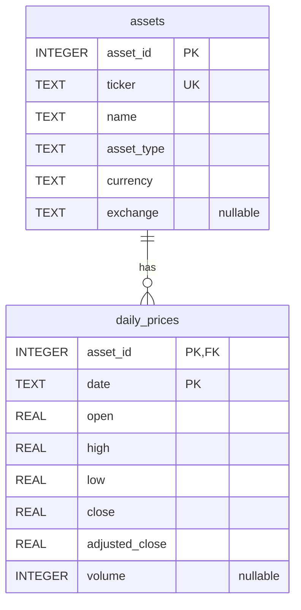

# Database schema

The database is SQLite, created entirely from two SQL scripts:

- `database/schema.sql`: table definitions and constraints.
- `database/seed_assets.sql`: the asset universe.

`database/connection.py` applies both scripts in a single transaction.

## Diagram

## Design decisions

### Only raw observations are stored

There is no metrics table. Returns, volatility, correlation and drawdown are calculated at query time:

- Cumulative return and maximum drawdown depend on the period selected by the user, so a stored value would only be valid for one period.
- Yahoo Finance recalculates the whole adjusted price history after every dividend or split. Stored metrics would silently become stale after such a reload.
- The data volume (seven assets, daily observations) is small enough to calculate on the fly.

### Normalised asset metadata

Ticker, name, type, currency and exchange are stored once in `assets`. `daily_prices` only holds `asset_id`, so metadata changes never require updating price rows.

The seed uses `INSERT ... ON CONFLICT (ticker) DO UPDATE`, so it can be re-run safely: metadata is updated, nothing is duplicated, and `asset_id` values stay stable.

### Primary key of `daily_prices`

The composite key `(asset_id, date)` guarantees one observation per asset and day, which is what prevents duplicate rows during ingestion.

The column order is deliberate. All analytical queries use `PARTITION BY asset_id ORDER BY date`, and with the key in this order SQLite reads each asset's history directly from the primary key. `(date, asset_id)` would enforce the same uniqueness but would need an extra index on `(asset_id, date)`.

The table is declared `WITHOUT ROWID`, so rows are stored physically in key order and no hidden rowid index is maintained.

No other indexes are defined. `assets.ticker` is indexed implicitly by its `UNIQUE` constraint, and joins between assets on the same date (used for correlations) resolve through the primary key.

### Dates

Dates are stored as ISO `YYYY-MM-DD` text, the format SQLite's date functions understand. The constraint `date(date) IS NOT NULL AND date(date) = date` rejects other formats (`2024/01/02`, `2024-1-2`) and impossible dates (`2024-02-30`).

The date is the exchange-local trading date for equities and indices, and the UTC calendar date for cryptocurrencies. Equity dates are not converted to UTC, because that could move a session to the wrong day.

### Constraints and NULL handling

| Column | Rule | Reason |
|---|---|---|
| `open`, `high`, `low`, `close`, `adjusted_close` | `NOT NULL`, `> 0` | A row without a valid price is useless for analysis and is rejected during ingestion. |
| `low`, `high` | `low <= open, close <= high` | Catches corrupted bars. |
| `volume` | Nullable, `>= 0` | Indices have no meaningful volume. NULL means "not available", which is different from 0. |
| `asset_type` | `equity`, `index` or `cryptocurrency` | Drives the annualisation factor (252 or 365). |
| `currency` | Three upper-case letters | ISO 4217 code. |
| `exchange` | Nullable | Indices and cryptocurrencies have no single listing exchange. |

Both tables are `STRICT`, so SQLite rejects values of the wrong type instead of storing them silently (for example, text in a price column).

### Referential integrity

`daily_prices.asset_id` references `assets.asset_id` with `ON DELETE RESTRICT`: an asset with stored prices cannot be deleted by accident.

SQLite only enforces foreign keys when `PRAGMA foreign_keys = ON` is set on each connection. This cannot live in the schema file, so `get_connection()` sets it every time.

### Transactions

`initialize_database()` wraps both scripts in a single `BEGIN ... COMMIT`. If any statement fails, the transaction is rolled back and the database is left unchanged.

## Requirements

SQLite 3.37 or later (for `STRICT` tables). `get_connection()` checks the version bundled with Python and fails with a clear error if it is older.

## PostgreSQL differences

- `STRICT` and `WITHOUT ROWID` are SQLite-specific. PostgreSQL is strictly typed by default and always stores tables as heaps with separate indexes.
- Dates would use the native `DATE` type, which makes the format check unnecessary.
- Foreign keys are always enforced; no per-connection setting is needed.
